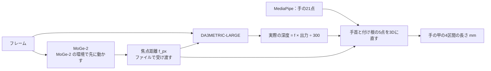

# しくみと方法（Depth Anything 3）

> **このドキュメントで決めたこと**
> 1. DA3METRIC-LARGE の出力（焦点距離を掛ける前の「標準の深度」）に、**ほかから持ってきた焦点距離を掛けて300で割り**、実際の深度（mm）にする。そこから先（手首と付け根の点を3Dに直し、手の甲の4区間を出す）は Depth Pro の実験と同じ。
> 2. 焦点距離の出どころを変えて、4つの組み合わせを比べる（§3）。本命は「MoGe-2 の焦点距離」。Depth Pro の焦点距離は、研究目的の物差しとしてだけ使う。
> 3. **焦点距離は「DA3 が実際に見た画像の大きさ」での px に合わせる必要がある**（DA3 は中で画像を縮める）。ここを誤ると長さがそのまま何倍もずれるので、コードを読んで最初に確かめる（§5）。

関連：[README.md](README.md)、[scripts.md](scripts.md)、MoGe-2 の [method.md](../depth-scale-moge2/method.md)

---

## 1. なぜこの組み合わせか

- **Depth Pro**：焦点距離も大きさも正確だったが、重みが研究目的だけで、本番に使えない
- **MoGe-2**（MIT）：焦点距離は Depth Pro と差1%で正確。大きさ（倍率）の推定だけが、この近さの手で外れた（長さが約1.8倍）。形（区間どうしの比）は正確
- **DA3METRIC-LARGE**（Apache-2.0）：焦点距離を自分で推定できない。そのかわり、焦点距離を与えると「焦点距離 × 出力 ÷ 300」で実際の深度を出す（公式の FAQ）
- 2026年10月のベンチマーク論文（arXiv 2610.27199）では、正しい焦点距離を与えたときの誤差が、DA3METRIC-LARGE で 12.3%、Depth Pro で 12.0% とほぼ同じ。同じ論文で、MoGe-2 が自分の焦点距離と大きさで使ったときは 19%（今回の結果と合う）。ただし1つの研究だけで、近い距離での精度は調べていない

つまり「焦点距離は MoGe-2 から、深度（大きさ）は DA3METRIC から」借りれば、どちらも本番で使えるライセンスのまま、Depth Pro に近い精度が出る見込みがある。

## 2. しくみ

- 3Dに直す式は Depth Pro の実験と同じ（[../depth-scale/method.md §1.1](../depth-scale/method.md#11-2dの点を3dにする式)）。焦点距離は、深度に掛けたものと同じ値を使う
- 焦点距離は MoGe-2 の環境で先に出してファイルに保存し、DA3 の環境で読む（2つのモデルを同じ環境に入れない。ライブラリの版がぶつかっても壊さないため）

## 3. 試す組み合わせ

| 名前 | 焦点距離の出どころ | 深度 | 確かめたいこと |
|---|---|---|---|
| ① `da3+depthpro` | Depth Pro | DA3METRIC | **DA3 の深度そのものが正確か**（焦点距離が正しいときの上限）。研究目的の物差しとしてだけ使う |
| ② `da3+moge2` | MoGe-2（`vits` と `vitl`） | DA3METRIC | **本番で使える本命**。①にどれだけ近いか |
| ③ `moge2*da3` | — | MoGe-2 の形を、DA3 の深度で伸び縮み | 形と倍率を分ける方法（§4）。②より良くなるか |
| ④ `da3+da3base` | DA3 の `DA3-BASE`（カメラの情報も推定する） | DA3METRIC | MoGe-2 を使わず、DA3 だけで済むか（本番が軽くなる） |

### 結果での判断

| 結果 | 判断 |
|---|---|
| ①が外れる | DA3 の深度自体が、近い距離の手では合わない。組み合わせを変えても直らないので、予備の候補（MapAnything、`map-anything-apache`、Apache-2.0）に移る |
| ①は合うが②が外れる | MoGe-2 の焦点距離が足を引っ張っている。④を試すか、焦点距離の別の出し方を探す |
| ②が合う | 本番で使える組み合わせが見つかった。動画での比較（3人×3回）に進む |
| ④が②と同じくらい合う | モデルが1種類で済むので、本番ではこちらを選ぶ |

## 4. 形と倍率を分ける方法（③）

1. MoGe-2 で出した、手首と付け根の5点の3D位置（カメラからの距離 `z_moge`）と、4区間の長さ `L_moge` を使う（MoGe-2 の実験の出力）
2. 同じ5点で、DA3 の深度（焦点距離は MoGe-2 のもの）`z_da3` を出す
3. 倍率 `s = median(z_da3 ÷ z_moge)`（5点の中央値）
4. 長さ `L = s × L_moge`

MoGe-2 の形（区間どうしの比）は正確だったので、倍率だけを DA3 から借りる。本番の手のメッシュの実寸化（形は SAM 3D Body、倍率は1円玉）と同じ考え方。

## 5. 確かめること（要確認）

| 項目 | なぜ大事か | 確かめ方 |
|---|---|---|
| **DA3 が中で画像を何pxに縮めるか**（既定の処理の大きさ）と、「÷300」の式の焦点距離を、どの大きさの画像の px で数えるか | 元の画像の px の焦点距離をそのまま使うと、縮めた割合だけ深度がずれる | コードを読む。① で Depth Pro の焦点距離を使ったとき、手首までの距離が Depth Pro（221mm）と近くなるかで確かめる |
| 出力の `depth` が、焦点距離を掛ける前の値か、すでに実際の深度か | 二重に掛けると大きくずれる | コードと FAQ を読む |
| 自分で焦点距離（カメラの情報）を渡せるか | 渡せれば、式を自分で当てはめなくて済む | コードを読む（`inference` の引数） |
| 出力の深度の画像の大きさ（元の画像と同じか、縮めた大きさか） | 点の位置（px）を合わせるため | 動かして確かめる |
| `DA3-BASE` が1枚の写真からカメラの情報を推定できるか、その正規化の形 | ④のため | コードを読み、Depth Pro・MoGe-2 の焦点距離と比べる |
| 入れ方（PyPI の `depth-anything-3` か、コミットを固定して入れるか）、`xformers` が要るか、Python 3.12・numpy 2・PyTorch 2.14.1 で動くか | 環境づくり | 入れて動かす |

## 6. ライセンス

| 対象 | ライセンス | 確かめた所（2026-11-08） |
|---|---|---|
| Depth Anything 3 のコード | Apache-2.0（Copyright 2025 The Depth Anything 3 Team） | GitHub の LICENSE |
| `DA3METRIC-LARGE` の重み | Apache-2.0 | Hugging Face のモデルのページの表示 |
| `DA3-BASE` の重み | Apache-2.0 | GitHub の README の表だけ（モデルのページは未確認） |
| `DA3-LARGE`・`DA3-GIANT`・`DA3NESTED-GIANT-LARGE` | **CC BY-NC 4.0（非営利だけ）** | 使わない |
| MoGe-2（焦点距離） | MIT | [../depth-scale-moge2/tasks.md §3](../depth-scale-moge2/tasks.md#3-ライセンスの記録) |

- 本番で使う場合は、著作物利用シートと README に「Depth Anything 3（Apache-2.0）」「MoGe-2（Microsoft、MIT）」を書き、重みを配るなら Apache-2.0 の表示（NOTICE があれば、それも）を添える
- **非営利の版（Large・Giant・Nested）を間違えて使わない。** スクリプトでは、使うモデルの名前を決め打ちにする
- プライバシーは Depth Pro の実験と同じ（[../depth-scale/method.md §6](../depth-scale/method.md#6-プライバシーの扱い)）
