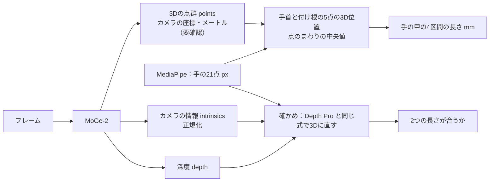

# MoGe-2 のしくみと使い方

> **このドキュメントで決めたこと**
> 1. MoGe-2 の出力のうち、**3Dの点群（`points`、各画素の3D位置）**から手首と指の付け根の5点の3D位置を取り、手の甲の4区間の長さを出す。確かめとして、深度（`depth`）とカメラの情報（`intrinsics`）から Depth Pro と同じ式で3Dに直した長さも出し、2つが合うかを見る。
> 2. 使うモデルは `Ruicheng/moge-2-vitl-normal`（大きい版）を第1にし、`Ruicheng/moge-2-vits-normal`（小さい版）も比べる。小さい版で精度が足りれば、本番で動かしやすい。
> 3. コードも重みも MIT（中の DINOv2 の部分は Apache-2.0）なので、本番の候補にできる。ただし Hugging Face のモデルのページは説明文が空で、ライセンスの表示（`mit`）だけなので、使うときは表示の写しを残す。

関連：[README.md](README.md)、[scripts.md](scripts.md)、Depth Pro 側の [method.md](../depth-scale/method.md)

---

## 1. しくみ

MoGe-2 は、2段階で考える。

1. **形を推定する**：大きさは分からないが、形（出っ張り・凹み・面の向き）が正しい3D点群を作る（前の版の MoGe と同じ）
2. **実際の大きさを推定する**：画像全体の特徴から「全体で何倍か」（倍率）を、別の小さな部品で推定し、1に掛ける

カメラの情報（焦点距離）は、与えなければ自分で推定する。与えることもできる（水平の画角 `fov_x`、度）。

## 2. 出力の扱い

| 出力 | 形 | 扱い |
|---|---|---|
| `points` | (H, W, 3) | 各画素の3D位置。OpenCV のカメラの座標（x 右、y 下、z 前）。単位はメートルと見込むが要確認（§5）。mm に直して使う |
| `depth` | (H, W) | 各画素の深度。確かめ用 |
| `intrinsics` | (3, 3) | **正規化された**カメラの情報。px の焦点距離に直す式は、MoGe のコードを読んで確かめる（要確認。画像の幅・高さで割った値と見込む） |
| `mask` | (H, W) | 使える画素の印。点のまわりの値を取るとき、印のない画素は除く |
| `normal` | (H, W, 3) | 面の向き。今回は使わない |

### 2.1 点のまわりの3D位置

- 手首と付け根の5点（0・5・9・13・17）のそれぞれで、点を中心とする半径 r px の円の中の、`mask` があり有限な画素の `points` を集め、**x・y・z それぞれの中央値**をその点の3D位置にする。既定は r = 3（Depth Pro の実験と同じ）
- 皮膚の表面と関節の中心のずれ（[Depth Pro 側の method.md §2](../depth-scale/method.md#2-精度の見積もり)）は、Depth Pro の実験と同じく「深度に足す量」として試す。点群では、カメラから点への向きに沿って、その量だけ遠ざける

### 2.2 確かめ：深度とカメラの情報から3Dに直す

- `intrinsics` を px の焦点距離 `f_px` に直し、`depth` と MediaPipe の点（px）から、Depth Pro と同じ式（[Depth Pro 側の method.md §1.1](../depth-scale/method.md#11-2dの点を3dにする式)）で3Dに直す
- §2.1 の長さと、この長さの差が 0.5% を超えたら、`intrinsics` の直し方か単位の読み方を誤っている見込みが高い（目安。要確認）
- この確かめで `f_px` が出るので、Depth Pro の焦点距離とも並べて比べられる

## 3. ほかの候補と比べた結果

2026-11-08 に公式のページ（GitHub と Hugging Face）で確かめた。

| モデル | コード | 重み | 商用 | 焦点距離を推定 | 判断 |
|---|---|---|---|---|---|
| **MoGe-2**（Microsoft） | MIT | MIT（表示だけ） | ○ | ○ | **採用（この実験）** |
| Depth Pro（Apple） | Apple 独自 | 研究目的だけ | × | ○ | 実験の物差しとしてだけ使う（[../depth-scale/](../depth-scale/tasks.md)） |
| Depth Anything 3 `DA3METRIC-LARGE` | Apache-2.0 | Apache-2.0 | ○ | ×（「焦点距離 × 出力 ÷ 300」で深度にする） | 次の候補 |
| Depth Anything V2 Metric（Small） | Apache-2.0 | Apache-2.0（Small だけ） | ○ | × | 焦点距離が取れないので後回し |
| Metric3D v2 | BSD-2 | 未確認 | コードは○ | × | 重みのライセンスが未確認 |
| ZoeDepth | MIT | 未確認 | コードは○ | × | 開発が止まっている |
| UniDepth・UniK3D | CC BY-NC（UniK3D は BY-NC-SA の表記もある） | — | × | ○ | 非営利だけなので使えない |

- MoGe-3（2026年8月）も出ているが、ライセンスは未確認。MoGe-2 の結果を見てから考える

## 4. 使うモデル

| モデル | 大きさ | 使い道 |
|---|---|---|
| `Ruicheng/moge-2-vitl-normal` | 大きい（ViT-L） | 第1。精度の上限を見る |
| `Ruicheng/moge-2-vits-normal` | 小さい（ViT-S） | 本番で動かしやすい。精度がどれだけ落ちるかを見る |

- 重みは `experiments/depth_scale_moge2/checkpoints/`（Hugging Face のキャッシュの置き場所）に置き、コミットしない
- 大きさ（ファイルの容量・パラメータの数）と、手元のGPUでの時間は要確認（[tasks.md](tasks.md)）

## 5. 確かめること（要確認）

| 項目 | 確かめ方 |
|---|---|
| `points`・`depth` の単位（メートルか） | コードを読む。机の上の物（定規）を写して、だいたいの距離が合うかを見る |
| 正規化された `intrinsics` を px に直す式 | MoGe のコード（`utils3d` を含む）を読む。§2.2 の確かめで、点群からの長さと合うか |
| 入力の大きさ（`num_tokens` などの引数）の既定と、精度・時間への効き方 | コードを読み、既定で試してから、大きくした場合と比べる |
| Python 3.12 と、今の numpy 2.5.4・PyTorch 2.14.1 で動くか | 入れて動かす（別の仮想環境にする。[scripts.md §6](scripts.md#6-環境と決まり)） |

## 6. ライセンスとプライバシー

- **コード**：MIT（Copyright (c) Microsoft Corporation）。`moge/model/modules/dinov2` は Meta AI の Apache-2.0
- **重み**：Hugging Face のモデルのページの表示は `License: mit`。説明文は空。表示の写し（ページの URL と日付）を `tasks.md` に残す
- **本番で使う場合**：著作物利用シートと README に「MoGe-2（Microsoft、MIT）」「DINOv2（Meta AI、Apache-2.0）」を書く。重みをイメージに入れて配るなら、MIT の著作権の表示を添える
- **プライバシー**：Depth Pro の実験と同じ（[../depth-scale/method.md §6](../depth-scale/method.md#6-プライバシーの扱い)）。実験の写真・動画はコミットしない場所でだけ使い、終わったら消す
