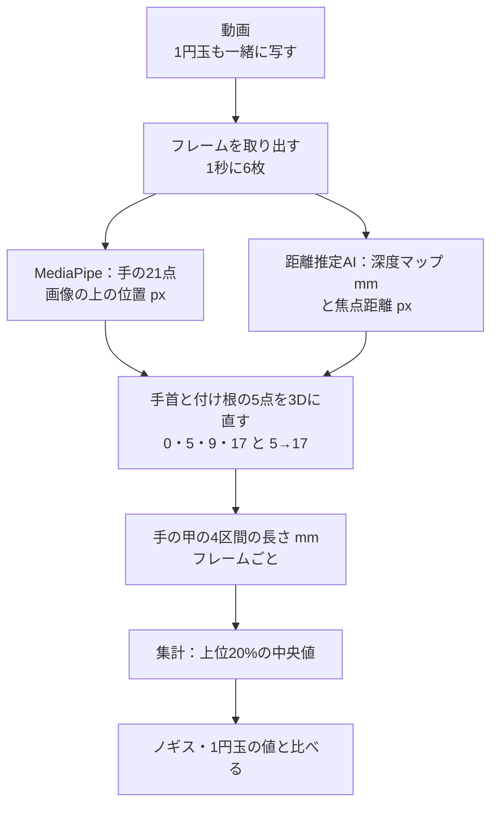

# しくみと方法

> **このドキュメントで決めたこと**
> 1. AIで各点の深度（カメラからの距離、mm）と焦点距離（px）を推定し、MediaPipe の手首と指の付け根の点を3Dの位置（mm）に直して、手の甲の4区間の長さを出す。集計は本番と同じ「上位20%のフレームの中央値」（[measurement.md §7.1](../measurement.md#71-長さ上位20のフレームの中央値)）。
> 2. 実験は手元のGPUで、本番とは別のスクリプトで行う。候補のモデルは Depth Pro を第1候補にし、ライセンスを確かめてから使う。
> 3. 実験の動画は、チームのメンバーが自分の手を撮って同意したものだけを、リポジトリの外に置いて使い、実験が終わったら消す。

関連：[README.md](README.md)、[experiment.md](experiment.md)

---

## 1. 流れ



### 1.1 2Dの点を3Dにする式

画像の上の位置 `(u, v)`（px）、その点の深度 `Z`（mm）、焦点距離 `f`（px）、画像の中心 `(cx, cy)` から、カメラから見た3Dの位置を出す。

```
X = (u − cx) × Z ÷ f
Y = (v − cy) × Z ÷ f
区間の長さ L = |P_i − P_j|（P = (X, Y, Z)）
```

- `Z` は、点のまわり（半径3px程度）の深度の中央値を使う。点がちょうど物の境目に乗ると、背景の深度を拾うため（半径は要確認）
- `f` が分からないと、大きさが決まらない。ブラウザのカメラ（`getUserMedia`）からは焦点距離が取れないので、**AIが焦点距離も推定できるか**が大事になる（§3）

### 1.2 本番の流れとのつなぎ方（採用する場合の案）

- 出した4区間の長さを、1円玉から出した長さの代わりに、倍率 k の計算（[measurement.md §8.2](../measurement.md#82-メッシュの合成と実寸化)）に入れる。それ以降は変えない
- 採寸の JSON に、大きさの基準が何かを記録する（例：`scale_source: "coin" | "depth_ai"`）。警告コード（例：`SCALE_ESTIMATED`）を足し、OT 画面で「大きさはAIの推定です」と目立たせる
- これらは案で、実験で合格してからチームで決める

## 2. 精度の見積もり

- 上の式では、長さは `Z ÷ f` に比例する。そのため、**深度が x% ずれると、長さもほぼ x% ずれる**。焦点距離が x% ずれても同じ
- 必要な精度は約2%。カメラから手までが約300mmなら、深度のずれは約6mm以内、焦点距離のずれも約2%以内にしたい
- **深度は皮膚の表面の距離で、MediaPipe の点は関節の中心**（[measurement.md §5](../measurement.md#5-使うランドマーク)）。上から撮ると、手の甲の皮膚は関節の中心よりカメラに近い。その差を約10〜15mmとすると、深度が3〜5%短く出て、長さもその分短く出る（差の大きさは要確認）。これは毎回同じ向きのずれなので、補正係数（`k_len` と同じ考え方。[measurement.md §10.3](../measurement.md#103-補正係数の求め方)）で直せる見込み
- 多くのモデルは、部屋や屋外の景色（数m〜数十m）で学習している。**30cmほどの近さ**でどれだけ当たるかは分からない。実験で確かめる一番の点

## 3. 候補のモデル

| モデル | 焦点距離 | 特徴 | ライセンス |
|---|---|---|---|
| Depth Pro（Apple） | **AIが推定する** | 写真1枚から実際の距離と焦点距離を同時に出す。カメラの情報がなくても使える | コードは使う・直す・配ることを認める。**重みは研究目的だけ**（`apple-amlr`）で、本番には使えない（[tasks.md §3](tasks.md#3-ライセンスで分かったことds12026-11-07)） |
| UniDepth | AIが推定する | カメラの情報を推定しながら実際の距離を出す | 要確認（利用に制限がある可能性） |
| Metric3D v2 | 与える必要がある | 焦点距離が分かれば精度が良いとされる | 要確認 |
| Depth Anything V2（メトリック版） | 与える必要がある | 軽い版がある。ブラウザで動かせる可能性がある | 要確認（モデルの大きさによって違う可能性） |

- **実験の第1候補は Depth Pro**。焦点距離が取れないブラウザの条件に合うため。ただし重みは研究目的だけなので、**実験で「この方式で精度が出るか」を確かめるためだけ**に使う。本番に入れるなら、商用でも使えるモデルを選び直す
- 焦点距離を与える必要があるモデルは、実験では「スマホの機種の焦点距離（35mm換算の値）から計算した値」を与えて、上限の精度を見る。本番のブラウザではこの値が取れないので、そのままでは使えない
- ライセンスは、公開の提出用リポジトリと著作物利用シートに関わるので、**使う前に必ず確かめる**（[tasks.md](tasks.md)）

## 4. どこで動かすか

| 置き場所 | 良い点 | 問題 |
|---|---|---|
| 実験：手元のPC（GPU。2026-11-07 に環境を作ったPCは RTX 3080 Ti Laptop、16GB） | すぐ試せる。費用がかからない | — |
| 本番の案1：`hand-mesh`（Cloud Run GPU）に足す | 同意を得てフレームを受け取る仕組みとGPUがある | いまは**手を切り抜いたフレーム**（長い辺512px）しか送っていない。切り抜くと周りの景色と画角の手がかりが減り、推定が悪くなるおそれがある。費用（`DAILY_COST_LIMIT_USD`）にも足される |
| 本番の案2：ブラウザ | 映像が端末の外に出ない | モデルが重い。スマホで動くかと速さは要確認 |

- 案1を選ぶには、**切り抜いたフレームでも推定できるか**を実験で確かめる（[experiment.md §3](experiment.md#3-比べる条件)）
- 切り抜く前のフレームを送るなら、端末の外に出る画像が増える。同意の文（`mesh-consent-2`）とプライバシーの約束の見直しが要る

## 5. 実験のスクリプトの置き場所（案）

`experiments/depth_scale/` に置き、本番のコードとは分ける。ファイルの構成と各スクリプトの中身は [scripts.md](scripts.md) を正とする。

- MediaPipe は、実験では Python 版を使う見込み。本番のブラウザ版（`@mediapipe/tasks-vision` 1.2.2）と点の位置が少し違う可能性がある（要確認）
- 1円玉の方法の値は、同じ動画をアプリの「動画ファイルを選ぶ」で読み込ませ、手元の生成API（`.localstore/`）に保存された採寸の JSON から取る。こうすると、同じ動画で比べられる
- モデルの重みはリポジトリに入れない

## 6. プライバシーの扱い

本番の約束（動画を保存しない）は変えない。実験だけ、次の決まりで動画を使う。

- 撮るのは、**チームのメンバーが自分の手を撮り、実験に使うことに同意したもの**だけ。ほかの人の手は使わない
- 動画とフレームは `experiments/depth_scale/data/` に置き、`.gitignore` に入れて**コミットしない**。クラウドにも上げない
- 結果の表に残すのは、長さ（mm）と誤差（%）だけ。画像は残さない
- 実験が終わったら、動画とフレームを消す（遅くとも審査が終わる2026年12月まで）
